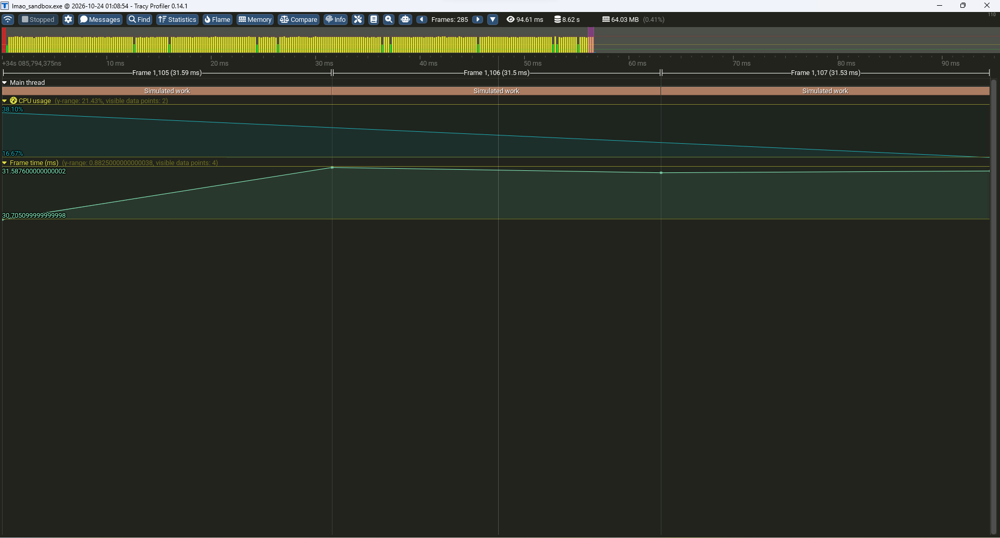

# Milestones

| # | Name | Status | Started | Done | Tag |
|---|------|--------|---------|------|-----|
| M0 | Foundation | ✅ Done | 2026-10-21 |2026-10-24|[M0](https://github.com/phapzip1/Lmao/releases/tag/M0)|
| M1 | Vulkan bootstrap | ✅ Done  |2026-10-24|2026-10-24| |
| M2 | Render core | ⏳ Planned | | | |
| M3 | Memory + jobs | ⏳ Planned | | | |
| M4 | Scene + assets | ⏳ Planned | | | |
| M5 | Render graph + lighting | ⏳ Planned | | | |
| M5b | D3D12 backend | ⏳ Planned | | | |
| M6 | 2D + text + localization | ⏳ Planned | | | |
| M7 | Physics | ⏳ Planned | | | |
| M8 | Audio | ⏳ Planned | | | |
| M9 | Animation | ⏳ Planned | | | |
| M10 | Scripting | ⏳ Planned | | | |
| M11 | AI | ⏳ Planned | | | |
| M12 | Streaming | ⏳ Planned | | | |
| M13 | Networking | ⏳ Planned | | | |
| M14 | Cinematics | ⏳ Planned | | | |
| M15 | Editor | ⏳ Planned | | | |

Rules:
- Exit criteria are fixed when a milestone starts. Tasks can change; criteria can't.
- Done means demo-able: each milestone gets a GIF, screenshot or runnable sample in `docs/demos/`.
- When a milestone closes, tag the commit (`git tag -a m<N> -m "M<N>: <name>"`) and fill in the table.

---

## M0 — Foundation 🚧

**Exit criteria**
- [x] CMake ≥ 3.25 + Ninja, `CMakePresets.json` (`windows-debug`, `windows-release`, `linux-debug`)
- [x] `third_party/` submodules for GLFW and Tracy, wrapped in `third_party/CMakeLists.txt`
- [x] Logging, asserts (break into debugger), crash dumps (`MiniDumpWriteDump`). Verified 2026-10-24: `LMAO_FATAL` logged, minidump written to `crashes/` and opened in Visual Studio
- [x] Platform interface (`core/platform/`) with a GLFW backend: window opens, input events are logged
- [x] High-resolution timer, basic math, basic containers
- [x] Tracy client connects and shows frame zones (Profiler 0.14.1, 2026-10-24)
- [x] CI builds on Windows (MSVC or clang-cl) and Linux (GCC or Clang). `windows-debug`, `windows-release` and `linux-debug` pass

**Tasks**
- [x] Git repository (branch `dev`)
- [x] `CLAUDE.md` with layering rules and conventions
- [x] `.gitignore`
- [x] Claude skills: `engine-build`, `add-dependency`, `vulkan-debug`
- [x] Folder layout (`engine/`, `third_party/`, `game/`). `tools/` and `shaders/` are created when first used in M2
- [x] `third_party/LICENSES.md`
- [x] Compiler warning settings (`/W4 /WX`, `-Wall -Wextra -Werror`) for engine targets (`cmake/LmaoWarnings.cmake`)
- [x] `windows-debug` and `windows-release` build
- [x] `linux-debug` builds (in CI)
- [x] Pin GLFW to a release tag (currently one commit past `3.5.1`)

**Notes / decisions**
- 2026-10-23: CMake 4.5 adds `import std` support to every C++20 target with module scanning on, which broke the C-only `glfw` target under Ninja. Module scanning is off project-wide (`CMAKE_CXX_SCAN_FOR_MODULES OFF`); the engine doesn't use C++ modules.
- 2026-10-24: Configuring outside a Visual Studio developer environment caches the wrong toolchain values (empty default flags, or GNU `ld` from a GCC on PATH). The root `CMakeLists.txt` now stops early when an MSVC compiler is cached with a non-MSVC linker.
- 2026-10-24: Tracy pinned to `v0.14.1` so the official prebuilt profiler (same protocol version) can connect. The profiler goes in `tools/bin/tracy/`.
- On Windows, `sleep_for(16ms)` lasts about 31 ms because of the default 15.6 ms timer tick. Real frame pacing will come from vsync (M1).

**Demo:** the sandbox profiled in Tracy 0.14.1: frame marks, the "Simulated work" zone and the frame-time plot.

---

## Exit criteria for later milestones

**M1 — Vulkan bootstrap**
- [x] Instance + debug messenger; validation errors break into the debugger. Tested on Windows by drawing without `SetScissor`: the dynamic-scissor error broke at `LMAO_DEBUG_BREAK()` in the messenger callback, 2026-10-24
- [x] Device selection requiring Vulkan 1.3 features. Picks the GTX 1650 and rejects the AMD iGPU (Vulkan 1.2 only), 2026-10-24
- [x] Swapchain + 2 frames in flight, one render-finished semaphore per swapchain image. Two frame slots paced by a timeline semaphore; acquire semaphore per frame, render-finished semaphore per image. Runs clean on Windows, X11 and Wayland, 2026-10-24
- [x] Triangle rendered through `Rhi::Device` (no Vulkan types outside `rhi/rhis/vulkan/`). Slang shader (embedded SPIR-V), `CreateGraphicsPipeline` + `Draw`; verified on Wayland and X11, Windows run still pending, 2026-10-24
- [x] Survives resize and minimize with zero validation or sync-validation messages. Sync validation on via `VK_EXT_layer_settings`; resize, minimize/restore and vsync toggling clean on Windows and X11, 2026-10-24

**M2 — Render core**
- [ ] VMA, staging uploads, bindless descriptors
- [ ] glTF model rendered with textures, camera and depth (reverse-Z)
- [ ] ImGui through the RHI
- [ ] Slang shaders with the fixed binding convention; shader hot reload
- [ ] Pipeline cache persisted to disk
- [ ] Null backend runs the same frame headless

**M3 — Memory + jobs**
- [ ] Frame, pool and TLSF allocators with per-subsystem tracking UI
- [ ] Work-stealing job system with counters
- [ ] Parallel command recording; Tracy shows work spread across cores
- [ ] No leaks at exit

**M4 — Scene + assets**
- [ ] ECS with transform hierarchy
- [ ] Reflection system
- [ ] Scene save/load
- [ ] Asset cooker + asset DB with GUIDs
- [ ] 10k entities spawned and rendered

**M5 — Render graph + lighting**
- [ ] Render graph with automatic barriers (abstract `ResourceState` only)
- [ ] PBR, shadow maps, HDR + tonemapping, frustum culling, debug draw
- [ ] Render graph visualizer
- [ ] Lit scene at a stable frame rate

**M5b — D3D12 backend**
- [ ] Same scenes and shaders render on D3D12
- [ ] Golden-image tests pass on Vulkan and D3D12 within tolerance
- [ ] D3D12 debug layer + GPU-based validation clean

**M6 — 2D + text + localization**
- [ ] Sprite batcher and tilemaps
- [ ] MSDF text with HarfBuzz shaping
- [ ] String tables with runtime locale switching, including one complex-script language
- [ ] Pseudo-locale

**M7 — Physics**
- [ ] Shapes, broadphase, narrowphase, sequential-impulse solver
- [ ] Raycasts, triggers, character controller
- [ ] Stable stack of 20 boxes; no tunneling for fast bodies

**M8 — Audio**
- [ ] Mixer, buses, streaming music, 3D sounds, ducking
- [ ] No glitches under heavy CPU load

**M9 — Animation**
- [ ] GPU skinning, clip playback, blend tree, state machine, two-bone IK
- [ ] Character walks and runs, blending on input

**M10 — Scripting**
- [ ] Lua VM with reflection-driven bindings
- [ ] Script hot reload
- [ ] A gameplay sample written entirely in Lua

**M11 — AI**
- [ ] Behavior trees with blackboard
- [ ] Navmesh + pathfinding, perception
- [ ] NPCs patrol, chase and lose the player

**M12 — Streaming**
- [ ] Async IO thread, transfer-queue uploads, LOD/mip streaming, memory budget
- [ ] Level larger than the VRAM budget loads with no hitch above 2 ms

**M13 — Networking**
- [ ] UDP transport with reliability layer
- [ ] Replication, client-side prediction, interpolation
- [ ] 2–4 players playable at simulated 150 ms latency and 5% packet loss

**M14 — Cinematics**
- [ ] Timeline asset with camera, animation, audio and subtitle tracks
- [ ] Scrubbing in the editor
- [ ] A scripted cutscene plays end to end

**M15 — Editor** (ongoing)
- [ ] Scene editor with reflection-driven inspector and gizmos
- [ ] Play-in-editor
- [ ] A level can be built without touching code
